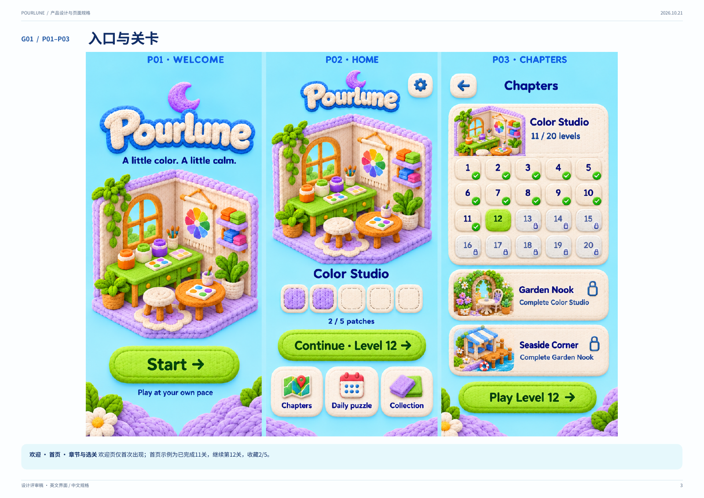
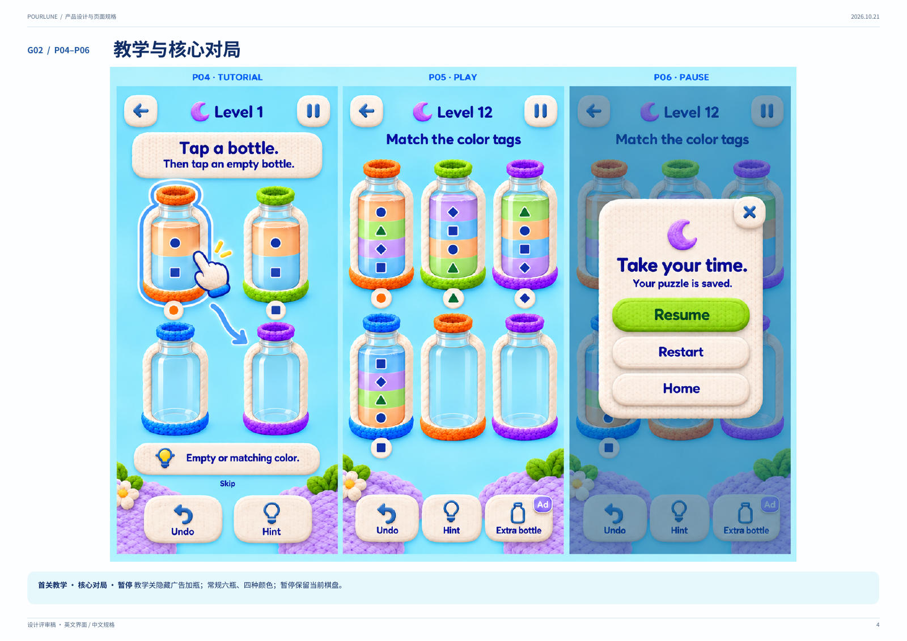
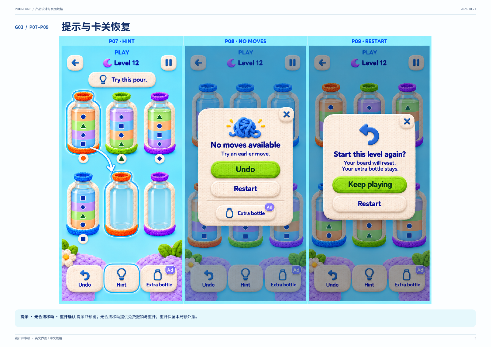
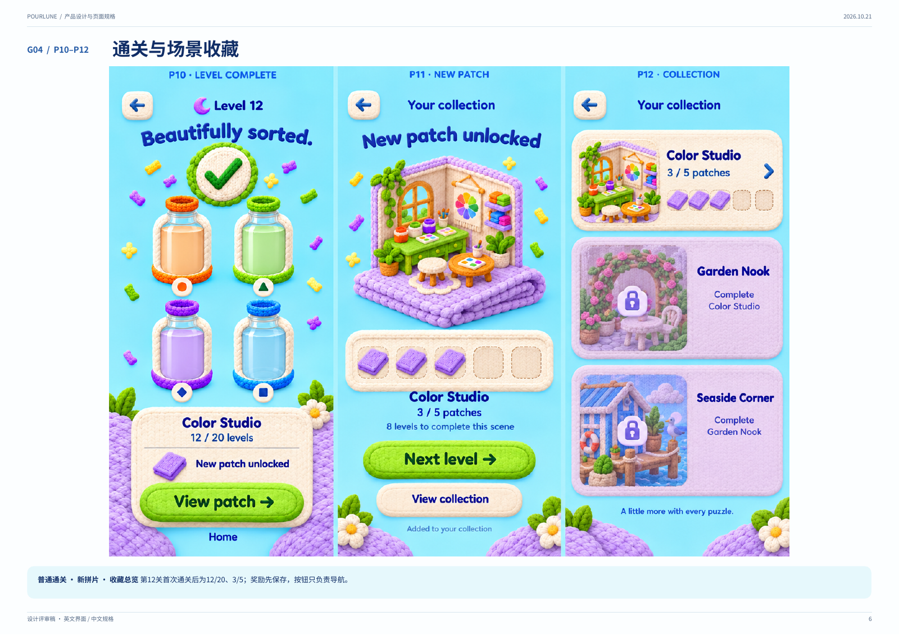
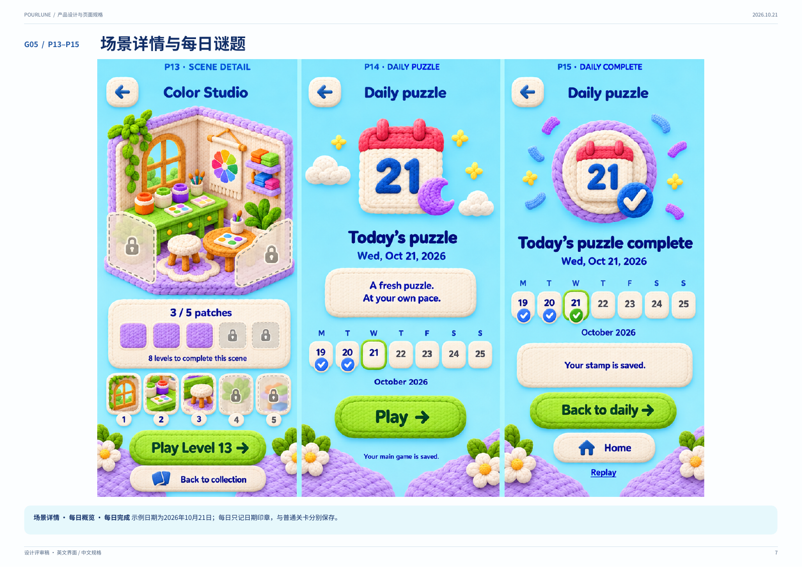
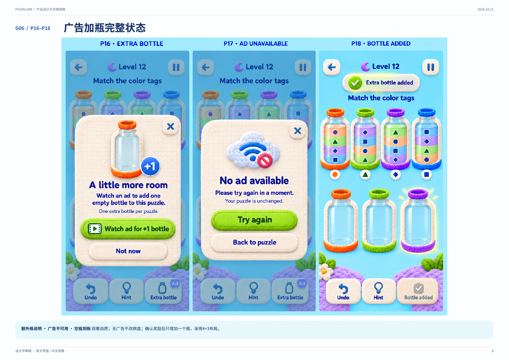
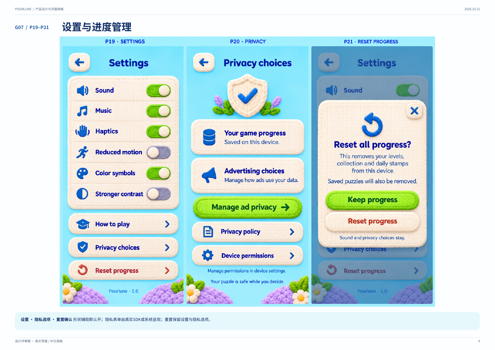

# Pourlune 原 UI 设计核验与增量清单

2026-10-21。结论：主页面视觉方案已存在，原设计可作为后续工作的基线；只需增量状态和一致性修正。不能把文件此前未取得理解为 UI 尚未设计。

## 1. 已恢复与已检查的证据

来源为 Chrome 中已登录的[原设计会话](https://chatgpt.com/c/6ad89215-f1dc-83e9-92dd-1a9e88ee22cd)的设计包下载入口。ZIP 完整性校验通过，共 15 个文件，原件未改动。

- [原始 PDF](../original/Pourlune_Design_Pack/Pourlune_Product_Design.pdf)：24 页，第 3–9 页为 UI，已逐页渲染并查看。
- [原始 PRD](../original/Pourlune_Design_Pack/PRD.md)：已读取相关规则与页面契约。
- [页面目录](../original/Pourlune_Design_Pack/screen_catalog.json)：7 组、P01～P21。
- [英文文案](../original/Pourlune_Design_Pack/UI_copy.csv)、[动效规格](../original/Pourlune_Design_Pack/Visual_and_Motion_Spec.md)、[第 12 关示例](../original/Pourlune_Design_Pack/Level12_Example_Validated.json)已恢复；未把文件存在当作运行测试通过。

此次验收是静态设计核验，不是可操作 App 的端到端测试。未重新生成任何 UI 或素材。

## 2. 逐组检查

| 步骤 | 原稿范围 | 健康度与观察 | 下一步 |
|---|---|---|---|
| 1 | P01～P03，PDF 3 | 欢迎、首页、选关完整；2/5 拼片与继续 12、已完成 11 关一致 | 保留；补重玩身份与全通首页变体 |
| 2 | P04～P06，PDF 4 | 教学、常规棋盘、暂停完整；教学隐藏加瓶；暂停已有成功保存文案 | 补保存失败／未保存状态；提升容量、空瓶和目标配色辨识 |
| 3 | P07～P09，PDF 5 | 提示源与目标有高亮；无合法移动和重开确认完整，免费救援可见 | 补寻找中／超时／已确认无解变体，明确点击建议目标才执行 |
| 4 | P10～P12，PDF 6 | 通关→View patch→拼片→Next 的顺序已存在；12/20、3/5 一致 | 保留；补非拼片、重玩、章节和最终完成的按钮变体 |
| 5 | P13～P15，PDF 7 | 场景详情、每日入口、每日完成完整；每日 Replay 已画出 | 保留 Replay；补旧日继续与今日替换、记录只读等状态图 |
| 6 | P16～P18，PDF 8 | 加瓶说明、无库存、到账及禁用入口均已设计；7 瓶为 4+3 | 保留；补冷却和奖励确认后保存失败；核对重排后瓶子尺寸 |
| 7 | P19～P21，PDF 9 | 设置、隐私和重置确认完整；版本号已存在，取消重置为主按钮 | 保留；只补反馈入口等确有新增项，适配验证另做 |

### PDF 3 入口

### PDF 4 教学和棋盘

### PDF 5 提示和恢复

### PDF 6 通关和收藏

### PDF 7 每日和场景

### PDF 8 广告加瓶

### PDF 9 设置

## 3. 真正需要的增量

| 编号 | 证据与问题 | 补充范围 | 优先级 |
|---|---|---|---|
| D01 | P06 仅展示 Your puzzle is saved；原规则虽有失败提示，图中无失败变体 | 同组件补保存中、失败、Retry／Stay here、按钮可用性 | 高 |
| D02 | P07 有建议，P08 是无合法移动；没有画出寻找中和超时 | 补提示等待、可取消、超时及确认无解；不新增独立导航页 | 高 |
| D03 | P14 展示今日未完成、P15 展示今日完成；原 PRD 已写跨日选择，但未单独画出 | 在原每日页与 P09 共用确认组件补旧局日期、今日入口、替换确认 | 高 |
| D04 | P02 是主线继续 12；P10／11 是第 12 关拼片奖励示例 | 补重玩继续、非拼片／重玩结算、20／40 章节完成、60 全通变体；保留原按钮命名 | 高 |
| D05 | P16～18 已覆盖说明／无库存／到账，但未呈现冷却与已确认待保存 | 增加冷却与确认待写入状态；提前关闭无奖励可复用 P17 文案；不重画三个已有页 | 高 |
| D06 | P04 首关两个颜色区各代表 2 单位，但无 4 档刻度；教学蓝目标瓶的绿色瓶套与标签不同 | 增加轻量容量刻度；对照选择目标装饰与标签一致、缓冲瓶中性后的可读性，保持浅色液体与针织风格 | 中 |
| D07 | P02、P11／12 的房间接近完整，P13 的 3/5 才叠加锁定区 | 明确每块揭示区域，统一相同进度的首页／收藏／详情；生成完整阶段映射前先复用现有物件 | 中 |
| D08 | P18 下排瓶子在图中视觉上比上排更大，而原动效规格要求七瓶同尺寸 | 核对瓶体宽高基准并统一缩放；窄屏也须保持可点击 | 中 |
| D09 | 原 P19 已有版本号、色彩符号、增强对比和减少动态效果 | 不重做设置；仅补反馈入口及大字号／窄屏／增强对比样例 | 中 |

截图不能证明控件达到 48 逻辑像素或通过读屏操作。小屏、最大支持字号、点击命中与读屏顺序需原型／实际布局证明，避免对静态稿作过度结论。

## 4. 对此前判断和文档的纠正

- 不是缺少整套 UI：21 个主页面／状态已经画出。
- 跨日替换、固定目标胜利条件、每实例一瓶、两步广告确认、章节命名、结算先保存，原 PRD 已有。需要部分状态可视化，不应重新制定已有规则。
- P15 已有 Replay；撤回补充稿“当天不可重玩”的限制。
- P19 已有 Pourlune · 1.0；撤回“缺少版本号”的判断，反馈入口仍可补。
- 最新原广告回复明确保留累计资格，实际展示才清零；撤回固定 13／16／19 检查点且跳过清机会的默认，恢复累计门槛。13／16／19 只是每次成功的理想序列。
- 原冷却依据最后实际全屏展示时间，不是前台游戏时间；已修正补充稿与验收用例。
- 原最新回复的单会话 4 次、滚动 24 小时 8 次是建议值，尚无用户单独采纳证据；不写成已确认限制。

补充稿中章节完成保护等新提议继续标注为本次补充。原 PDF 保持原样，不能声称这次已修改 PDF 的旧广告数值。

## 5. 派发与验收状态

用户已授权新建并派发，现已创建“Pourlune ｜ App 设计 开发”（threadId：01a15eca-2b7f-70c1-978d-45dd735765f1，hostId：local），完整发送 D01～D09、原件路径、纠正规则及交付标准。交付目录为 docs/design/ui-addendum/，由本聊天独立验收，尚未标记通过。

静态主页面覆盖：已确认。新增状态已交付；2026-10-21 完成首轮独立截图与原型路径验收，整体未通过，R01–R05 已派发修复。七瓶布局和设置入口／排版样例有局部通过证据，详见 [UI 增量独立验收](ui-addendum-acceptance.md)。真实 App 与真机验证未执行；本轮跟进保持开启，修复后复验。
