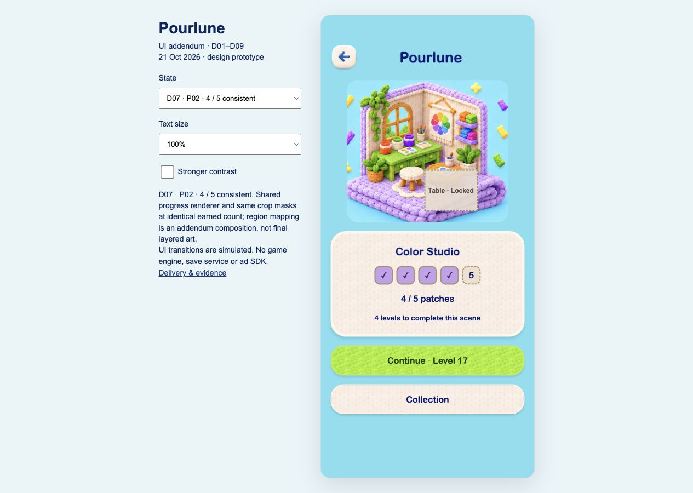
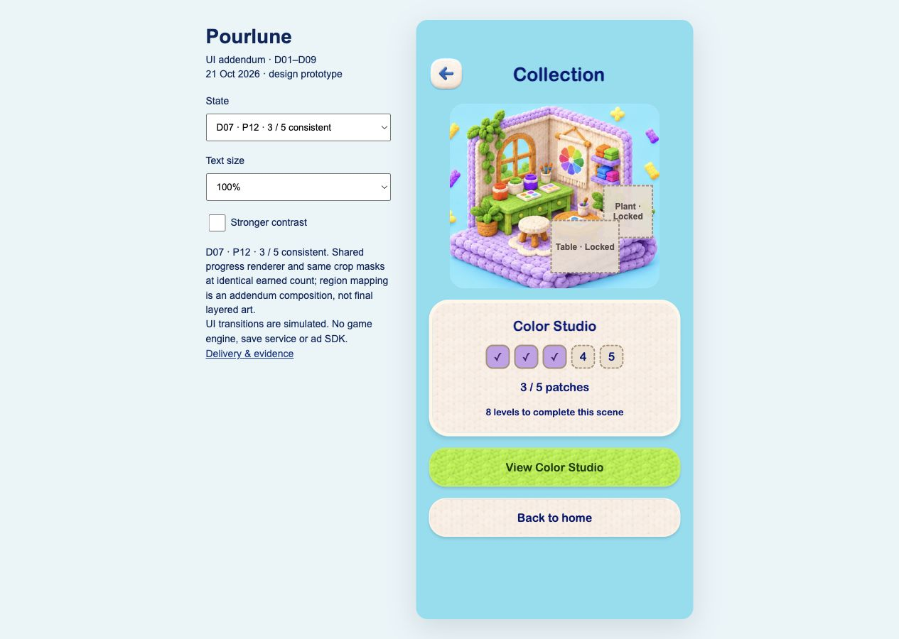
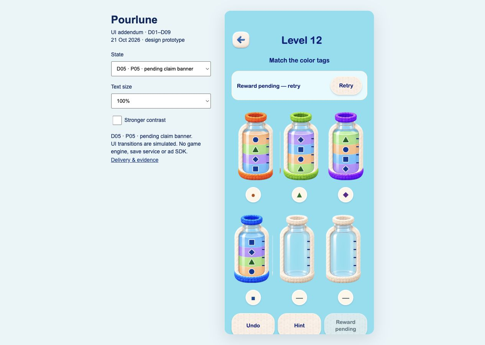
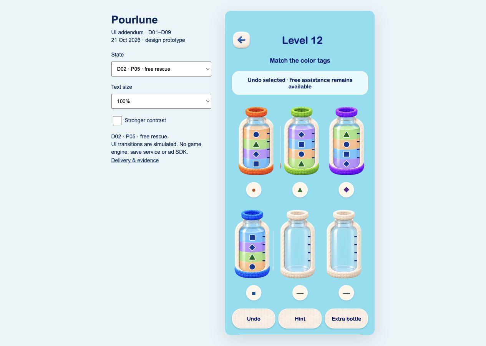
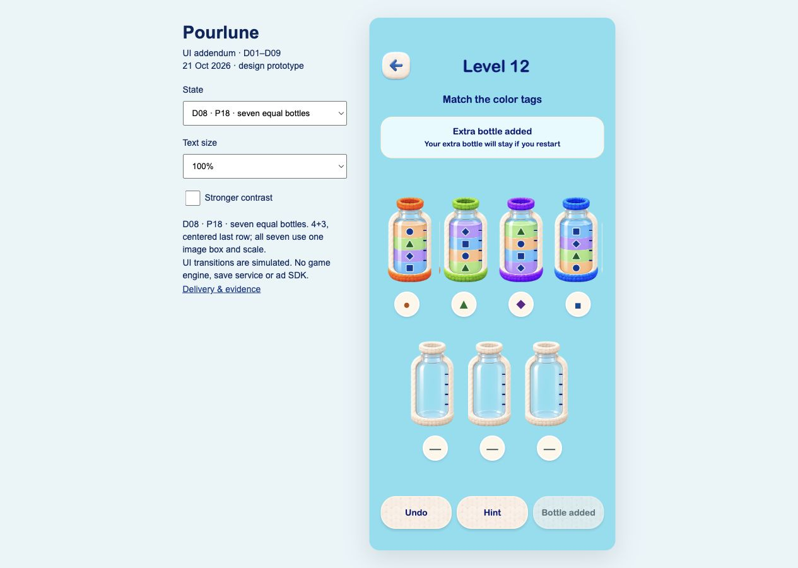
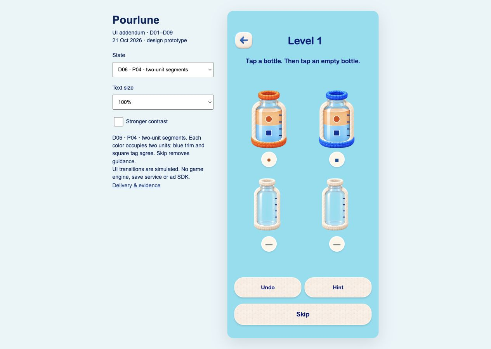
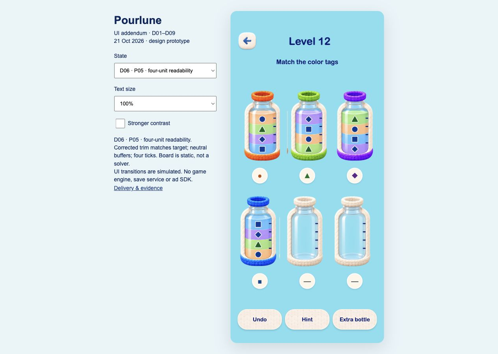
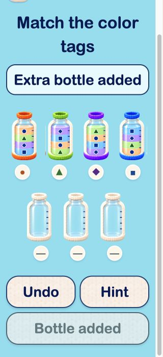
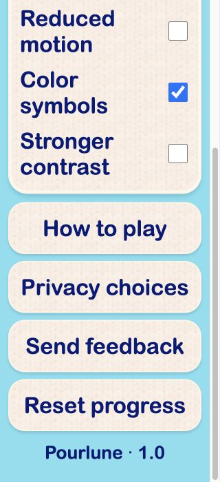

# Pourlune UI 增量独立验收

验收日期：2026-10-21–22（Asia/Taipei）\
验收方：Pourlune ｜ 产品架构\
执行方：Pourlune ｜ App 设计 开发\
当前结论（第三轮）：**D01–D09 在本次静态设计与有限 HTML 原型范围内通过，R01–R06 全部关闭。** 第 9 节为最终结论，第 1–8 节保留历史。通过不代表 Flutter、存档、SDK、真机或正式生产资源验收通过。

## 1. 范围与方法

依据 [原稿审查 D01–D09](original-design-review.md)、[UI 交付约定](../../pmpowers/specs/UI-design-handoff-and-review.md)、[产品补充稿](../../pmpowers/specs/PRD-supplement-v1.1.md) 和 [验收清单](../../pmpowers/specs/acceptance-and-content-readiness.md)。

实际打开并检查交付的 D01–D09 九张流程总览，重新查看原始教学／棋盘、激励广告与设置视觉板作对照；在 Codex 内置浏览器打开本地原型，实际点击关键路径并独立截图。常规预览为 390×844 的手机容器；窄屏实查为 320×700 浏览器、原型 200% 字号及增强对比样例。复查了保存弹窗、每日替换和设置的滚动底部。

原始设计包的 15 个文件重新与下载 ZIP 按字节比较，一致。独立证据位于 [ui-addendum-evidence](ui-addendum-evidence/manifest.json)，包含本轮截图、尺寸读数及交付源文件 SHA256。没有以执行方自查结果代替本报告。

本次审的是状态图与有限交互原型。以下问题要求修正可点击路径的显示语义，不要求开发真实游戏引擎、数据库、广告 SDK 或全部题库。

## 2. 逐项结论

| 步骤 | 编号与范围 | 本轮观察和健康度 | 结论 |
|---|---|---|---|
| 1 | D01 保存与失败恢复 | Retry 可到保存成功；保存失败、结算锁定文案已补。Stay here 后使用 Undo 会抹去未保存提示，见 R02 | 需修复复验 |
| 2 | D02 提示与救援 | 等待、超时、已确认无解有明确区别；但超时后的重开取消路径凭空加瓶，见 R03 | 需修复复验 |
| 3 | D03 跨日与每日重玩 | Oct 20 / Oct 21 替换确认和取消返回正确，未来日期禁用；旧日棋盘使用 Undo 后丢失日期和模式，见 R02 | 需修复复验 |
| 4 | D04 重玩和结算变体 | 非拼片、拼片、章节和第 60 关按钮变体已呈现，最终完成无 Next；重玩棋盘使用 Undo 后变普通 Level 12，见 R02 | 需修复复验 |
| 5 | D05 激励与奖励待保存 | 两步说明、冷却、待保存及迟到恢复说明已补；待奖励状态使用 Undo 后重新开放加瓶，见 R02；重开路径见 R03 | 需修复复验 |
| 6 | D06 容量与目标辨识 | 容量刻度、蓝目标与蓝装饰、中性缓冲已有证据；Skip 会换成 Level 12 六瓶局面，见 R04；部分单瓶边缘有残片，见 R05 | 需修复复验 |
| 7 | D07 收藏一致性 | 手动选同一进度状态时共享相同遮罩，但 4/5 首页进入收藏却变 3/5，见 R01 | 需修复复验 |
| 8 | D08 七瓶尺寸 | 原框架合成和自适应样例为 4＋3；独立实测 320 宽、200% 字号时七个瓶按钮均为 64.25×147 CSS px，底部操作滚动可达 | 本轮布局范围通过 |
| 9 | D09 设置与适配 | 原设置稿保留，新反馈入口可打开表单；200% 样例长文案和底部按钮可达，版本文字保留 | 本轮入口与排版样例范围通过 |

D08 通过不代表原生触控或真实动态瓶体通过；D09 通过不包括真实反馈发送、平台最大字号、读屏顺序、对比度合规和设置持久化。

## 3. 必须修复的问题

严重性以本轮原型验收为范围：P1 为核心流程显示与既有规则相悖，P2 为局部交互或视觉交付缺陷；均不表示已经发布的 App 存在这些故障。

### R01　P1　收藏跨页面进度回退（D07）

复现：评审选择器选 `home-4` → 页面显示 4/5，下一关 Level 17 → 点击 Collection → 到 `collection-3`，变 3/5、还差 8 关。来源是 app.js 的 collectionPage 对 Collection / Back to home 写死 3 片目标。

期望：同一进度的首页、收藏、详情、返回按钮始终保留 n。3、4、5 片均须走完整往返；顶栏 Back 也不能回到不相干的重玩首页。只需修正状态映射，不需要接存档。

### R02　P1　辅助操作丢失当前实例与待处理状态（D01／D03／D04／D05）

四条独立复现路径都落到通用 `hint-undo`：

| 起点与操作 | 实际结果 | 应有结果 |
|---|---|---|
| `reward-pending` → Stay here → Undo | Reward pending 和 Retry 消失；Extra bottle 重新可点 | 保留待奖励状态与重试入口，禁止重复领取 |
| `pause-stay` → Undo | Progress not saved 和 Retry 消失 | 在明确的保存成功事件前保留未保存提示 |
| `daily-old-board`（Daily · Oct 20）→ Undo | 变普通 Level 12，日期消失 | 保留每日模式、Oct 20 身份与原实例 |
| `replay-board`（Replay · Level 3）→ Undo | 变普通 Level 12 | 保留重玩标识与关卡身份 |

定位：app.js 的 boardMarkup 将 Undo / Hint / Back 指向共享默认状态；hint-undo 又用默认 boardMarkup 渲染。修复时保留最小的原型上下文或建立明确的状态返回映射，并检查 Hint → Cancel、暂停 → Resume、已加瓶局面的辅助操作同类路径。不得通过禁用免费辅助掩盖问题，也无需实现真实撤销或持久化。

每日身份对照：[操作前](ui-addendum-evidence/20-old-daily-board.jpg)、[操作后](ui-addendum-evidence/21-daily-undo-loses-identity.jpg)。未保存提示消失：[证据](ui-addendum-evidence/27-undo-clears-unsaved.jpg)。重玩身份消失：[证据](ui-addendum-evidence/28-replay-undo-loses-identity.jpg)。

### R03　P1　取消重开会凭空获得额外瓶（D02／D05）

复现：`hint-timeout` 的背景为六瓶 → Restart → 重开确认 → Keep playing → 到 `seven`，显示 Extra bottle added。未经过任何获奖确认；直接确认 Restart 也被写死指向 seven。

期望：取消保持原局与原瓶数；确认重开保持实例身份及已存在的额外瓶权益，不能凭空添加，也不能收回已获赠瓶。至少分别验证六瓶未加瓶、七瓶已加瓶两种上下文；每日和重玩沿用 R02 的身份保持。

### R04　P2　Skip 换关且开放额外瓶入口（D06）

复现：`tutorial` 显示 Level 1、两色四瓶，点击 Skip → `board`，显示 Level 12、四色六瓶与 Extra bottle。

期望：仅移除教学引导，保留 Level 1、当前局面和瓶数；首关仍隐藏加瓶。原型可以使用同一静态局面的自由状态，不需要实现教学引擎。

### R05　P2　单瓶裁片边缘残留细条（D06／D08）

在六瓶较大展示中，橙瓶和蓝瓶右侧可见与瓶体分离的竖向残片，缩到七瓶后仍能看到细线。定位已使用的 bottle-0 / bottle-3 等裁片，参考 [六瓶截图](ui-addendum-evidence/06-tutorial-skip.jpg) 和 [七瓶截图](ui-addendum-evidence/08-restart-cancel-adds-bottle.jpg)。

清理图像边界残片，同时保留容量刻度、透明通道和统一缩放；复查原框架与自适应两种呈现。不要求重新生成整套瓶体或改变视觉风格。

## 4. 已确认的改善与证据

- 保存失败明确区分内存保留与已落盘，直接 Retry 的结果正确：[保存成功](ui-addendum-evidence/02-save-retry.jpg)。200% 窄屏弹窗底部可滚动到 Retry / Stay here。
- 每日替换写明替换的是 Oct 20，保留普通主线；取消回到旧日继续入口：[取消结果](ui-addendum-evidence/10-daily-cancel.jpg)。
- 第 60 关提供 Daily puzzle / View collection / Replay levels，不出现 Next：[最终完成](ui-addendum-evidence/19-final-complete.jpg)。
- 七瓶两行尺寸一致，窄屏大字号的操作区可滚动到达：

- 设置保留原针织视觉，并新增反馈入口；大字号研究与原稿复用明确分开。发送目的地未配置，不伪称已发送：

## 5. 后续生产与运行边界

Color Studio 的矩形遮罩目前只用于阶段映射说明，Garden Nook / Seaside Corner 仍为缩略素材。正式三场景透明分层、字体分发授权、真实反馈地址属于已登记的开发准备项，本轮不要求扩大 UI 任务去完成全部生产素材、注册账号或后台。

本轮没有验证真实写盘、强退恢复、SDK 回调、广告时钟、真实求解、液体动画、数据库迁移、全题库、原生触控与读屏、完整对比度或帧率。36 条 App 验收仍待执行。静态样例的通过项不能扩大为 App 或发布通过。

## 6. 修复与复验要求

执行聊天只在 `docs/design/ui-addendum/` 修复 R01–R05，更新相关文案、覆盖说明和真实截图，提供各复现路径的修复前后结果。不得修改原件或以改产品规格消除缺陷。复验由产品架构聊天重新点击路径并保存新证据；在复验通过前，整体状态保持未通过，保留跟进。

## 7. 第二轮独立复验（2026-10-21）

### 方法与当前逐项结论

验收方实际操作修订后的原型，记录 90 条交互观察，独立保存并检查 31 张截图；重新打开单瓶裁片并与原始视觉板比较。证据与源文件 SHA256 见 [第二轮清单](ui-addendum-evidence-r2/manifest.json)，逐步操作见 [交互记录](ui-addendum-evidence-r2/interaction-notes.json)。验收期间被记录的源文件没有变化，原始包 15 个文件与 ZIP 按字节一致。执行方的 41 项自查不作为独立验收结论。

| D 编号 | 当前结论 | 复验依据 |
|---|---|---|
| D01 | 待 R06 修复 | 未保存状态经过辅助操作、暂停和返回仍保留；Retry 模拟成功后解除。窄屏 200% 按钮断词 |
| D02 | 本轮设计与原型范围通过 | 超时重开的取消、确认均保持原有瓶数；免费辅助入口保留 |
| D03 | 本轮设计与原型范围通过 | Oct 20 身份在 Undo、Hint 取消、暂停恢复和重开后保留 |
| D04 | 本轮设计与原型范围通过 | Replay · Level 3 身份保留；第 60 关仍无 Next |
| D05 | 待 R06 修复 | 待奖励状态保持，重复领取禁用，显式 Retry 才模拟到账；窄屏 200% 按钮断词 |
| D06 | 本轮设计与原型范围通过 | Skip 保留首关两色四瓶和相同裁片；瓶边残片已清理，容量和目标辨识保留 |
| D07 | 本轮设计与原型范围通过 | 3/4/5 片首页、收藏、详情、返回一致，包括顶栏返回 |
| D08 | 本轮布局范围通过 | 320 宽、200% 下七瓶均为 64.25×147 CSS px，4＋3 排列；底部操作滚动可达 |
| D09 | 待 R06 修复 | 设置、反馈入口和滚动底部复验通过；跨页面大字号适配仍有 R06 |

### 已关闭问题

| 问题 | 独立复验结果与证据 |
|---|---|
| R01 | 3/4/5 片实际点击往返均保持对应进度和 Level 13/17/21；[4 片详情](ui-addendum-evidence-r2/02-scene-four.jpg)、[返回首页](ui-addendum-evidence-r2/03-home-four-return.jpg) |
| R02 | 待奖励、未保存、旧每日、重玩、已加瓶分别走 Undo、Hint → Cancel、暂停 → Resume。对应标识持续保留，未保存时暂停页 Home 禁用；[待奖励辅助操作后](ui-addendum-evidence-r2/05-pending-after-undo.jpg)、[旧每日](ui-addendum-evidence-r2/11-daily-old-board-after-helpers.jpg)、[重玩](ui-addendum-evidence-r2/11-replay-board-after-helpers.jpg) |
| R03 | 六瓶与七瓶分别取消和确认重开，未凭空加瓶或收回已有瓶；待奖励、未保存、每日、重玩上下文均保留。[六瓶确认后](ui-addendum-evidence-r2/14-six-restart-confirmed.jpg)、[七瓶确认后](ui-addendum-evidence-r2/15-seven-restart-confirmed.jpg) |
| R04 | Skip 前后仍为 Level 1、两色四瓶，四个瓶子的图像路径和语义标签完全一致；随后 Undo、Hint 取消仍保留，加瓶隐藏。[跳过前](ui-addendum-evidence-r2/17-tutorial-before.jpg)、[跳过及辅助操作后](ui-addendum-evidence-r2/18-tutorial-skipped-helpers.jpg) |
| R05 | 实际打开 bottle-0 / bottle-3 与完整六瓶、七瓶画面，原邻瓶竖向残片已消除，容量刻度及中性缓冲保留。[七瓶实查](ui-addendum-evidence-r2/19-seven-320-200-top.jpg)。原素材少量边缘柔化不据此认定为正式生产资源通过 |

### R06　P2　状态横幅的 Retry 在窄屏大字号下断词（D01／D05／D09）

条件：浏览器 320×700，原型字号 200%，Stronger contrast 开启。

1. `pause-stay` 的 Progress not saved 横幅中，Retry 被排为 `Retr` / `y` 两行。
2. `reward-pending` → Stay here → Undo，Reward pending — retry 横幅出现同样断词。

实际按钮宽 82 CSS px、高 87.203125 px、字体 28.16 px、左右 padding 各 5 px。定位 `style.css` 的 `.status .row button` 固定 `flex:0 0 82px`，叠加全局按钮 `overflow-wrap:anywhere`。应按可用空间换行布局或给按钮充分宽度，让完整单词可读、可点击；不能降低用户选定字号、隐藏 Retry 或裁切文本来消除症状。

证据：[未保存横幅](ui-addendum-evidence-r2/24-unsaved-320-200-retry-wrap.jpg)、[待奖励横幅](ui-addendum-evidence-r2/23-pending-undo-320-200-top.jpg)。

修复后检查两种横幅在 320 / 390 宽、100% / 200% 字号和对比增强开／关下的实际渲染；复验 Undo、Hint 取消、暂停恢复后仍保留标识，显式 Retry 才清除对应待处理状态。保留 R01–R05 的修复与七瓶统一尺寸，仅修改 `docs/design/ui-addendum/`，不得变更产品规则或原始包。

### 未验证范围

以上均为静态 UI 与有限原型。Retry 成功是原型状态切换，不是实际写盘或奖励 SDK 确认；撤销、求解与重开没有验证游戏核心。Flutter / Dart、SQLite 事务、强退恢复、SDK、真机可访问性、性能和正式资源接入仍未验收。生产素材及账号交接按已有准备清单继续，未扩大为本轮 UI 修复要求。

## 8. R06 修订交付与复验阻塞（2026-10-21）

执行方已交付 [R06 修订](../ui-addendum/REVISION-R06.md)，自查报告为 24/24 响应式组合及 41/41 回归通过。验收方读取实际 CSS，确认状态横幅已改为可换行、按钮按内容宽度排列；源文件哈希比较确认 app.js 与五张瓶体素材相对第二轮未变。上述信息不代替独立操作复验。

独立浏览器复验启动时，现有标签显示“无法访问此站点”。浏览器 URL 安全策略拒绝获取页面观察权限，并明确禁止通过替代浏览器、间接执行等方式绕过。验收方停止相关尝试，没有以作者截图、自查或源码推断认定 R06 通过。需用户在应用内浏览器手动打开可访问的本地原型后继续。

当前仍以第 7 节结论为准：R01–R05 关闭，R06 待独立复验，整体未通过。自动跟进已暂停以避免重复触发同一限制。用户已授权通过后将本次 UI 与验收文档一并提交到仓库；目前尚未提交或推送这些文件。

## 9. 第三轮独立复验与最终结论（2026-10-22）

用户手动打开原型后，浏览器访问恢复，前述阻塞解除。验收方在该标签实际操作并保存 [第三轮截图与源文件清单](ui-addendum-evidence-r3/manifest.json) 和 [交互记录](ui-addendum-evidence-r3/interaction-notes.json)，未运行执行方自查来替代独立验收。

| 步骤 | 检查范围 | 结果与证据 |
|---|---|---|
| 1 | R06 原条件：320×700、200%、增强对比 | 未保存及待奖励 Retry 完整单行；宽 101.85、高 50.60 CSS px，字号仍 28.16 px。[未保存](ui-addendum-evidence-r3/01-unsaved-320-200-contrast.jpg)、[待奖励 Undo 后](ui-addendum-evidence-r3/03-pending-after-undo-320-200.jpg) |
| 2 | 两种横幅 × 320/390 宽 × 100%/200% × 对比开/关，共 16 组合 | 全部实际渲染并保存查看，完整单词不拆分，无按钮横向裁切；100% 点击高度 48 px，200% 50.60 px。矩阵截图见清单 |
| 3 | 两种状态的 Undo → Hint → Cancel → 暂停 → Resume → Retry | 待处理标记经辅助操作持续保留，未保存暂停页 Home 禁用；显式 Retry 才显示保存成功或加瓶。[保存回执](ui-addendum-evidence-r3/02-unsaved-explicit-retry.jpg)、[奖励到账](ui-addendum-evidence-r3/04-pending-explicit-retry-seven.jpg) |
| 4 | 未保存和待奖励并存，320 宽 200%，对比开/关 | Retry save 与 Retry reward 分别宽 171.81 / 205.35 px，字号 28.16 px，完整单行。辅助往返不清标记；先保存仅清未保存、先奖励仅清待奖励，之后可完成另一操作。[复合横幅](ui-addendum-evidence-r3/05-compound-320-200.jpg)、[先奖励](ui-addendum-evidence-r3/06-compound-reward-only-applied.jpg)、[先保存](ui-addendum-evidence-r3/08-compound-save-only-applied.jpg) |
| 5 | 七瓶与收藏回归抽查 | 奖励后七瓶按钮全部 64.25×147 CSS px，4＋3；4/5 首页 → 收藏 → 详情 → 返回收藏 → 首页仍 4/5、Level 17。[收藏返回](ui-addendum-evidence-r3/09-collection-four-return.jpg) |
| 6 | 仓库字体打包修正后复查 | 排除未确认分发授权的系统字体文件，CSS 改为 local() 引用，提取脚本不再复制字体。当前 Mac 重新加载后 Retry 与两个复合按钮尺寸、字号及视觉保持一致。[最终打包版本](ui-addendum-evidence-r3/11-packaging-local-font-compound.jpg) |

本轮关闭 R06（P2，D01/D05/D09）。D02/D03/D04/D06/D07/D08 沿用第二轮相应通过范围；app.js 与五张瓶体素材相对第二轮 SHA256 均未变化，前轮已关闭问题不重新标为未验。此次未重新执行第二轮全部 90 条观察；本轮独立检查范围以本节为准，不将执行方 24/24、41/41 自查计入独立检查数。

### 最终逐项状态

| 编号 | 最终结论 | 适用范围 |
|---|---|---|
| D01 | 通过 | 保存状态文案、异常返回和横幅适配；真实写盘未验 |
| D02 | 通过 | 提示状态、取消和救援路径；真实求解与撤销未验 |
| D03 | 通过 | 跨日选择、替换与身份保留；实际日期与存档未验 |
| D04 | 通过 | 结算／重玩／最终完成变体；真实进度事务未验 |
| D05 | 通过 | 奖励待保存、重试及原型状态隔离；广告 SDK 未验 |
| D06 | 通过 | 原型容量／标签／首关 Skip 与裁片清理；正式分层资源未验 |
| D07 | 通过 | 同进度入口及返回一致；三场景正式资源仍待制作 |
| D08 | 通过 | 七瓶同尺寸、布局和操作可达；真实动态瓶体未验 |
| D09 | 通过 | 设置与反馈入口、已检查的窄屏大字号样例；真实反馈发送与系统辅助功能未验 |

### 验收边界与提交说明

本轮交付共 27 张独立截图，包括横幅矩阵及操作结果；部分截图只显示滚动页面顶部，其用途是横幅排版证据，不据此认定整页均在首屏。完整操作通过实际按钮走查记录。

原始包保持不改动。系统字体本机副本不提交，仓库原型使用已安装的 Arial Rounded MT Bold，缺少该字体时回退 Arial / sans-serif；其他系统上的精确字形与换行不在本次视觉通过范围。Nunito 候选及 OFL 按既有生产交接执行。

UI 原型、前后修复证据、独立验收报告与第二／三轮证据一并纳入本次提交。真实 SQLite 事务、强退恢复、游戏核心、广告、Firebase、Flutter / Dart、真机可访问性和性能均未验收；未运行不存在的 App 工程命令。完成本轮设计跟进后删除自动跟进，不归档用户聊天。
