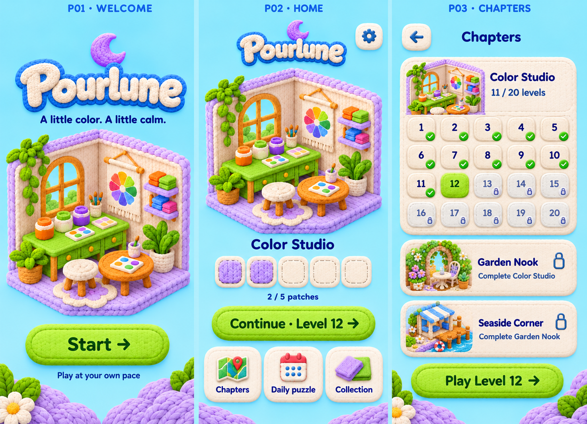
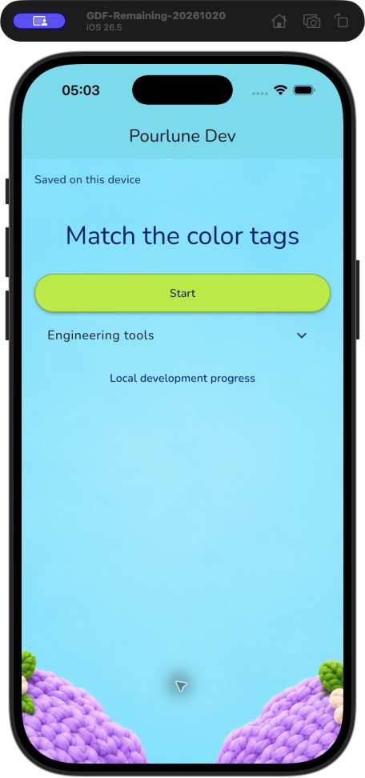
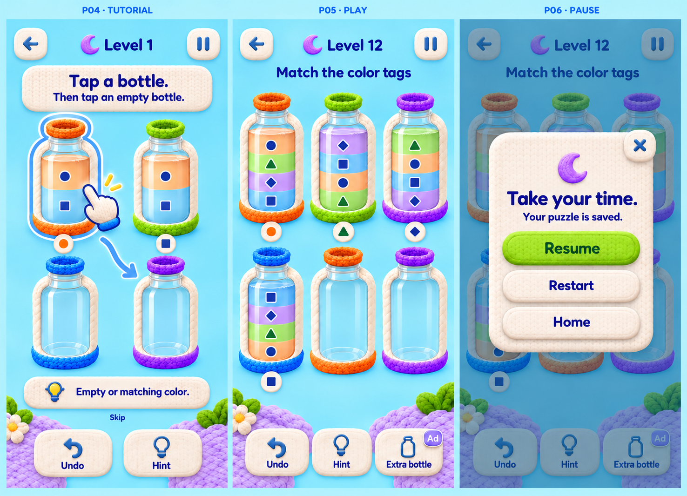
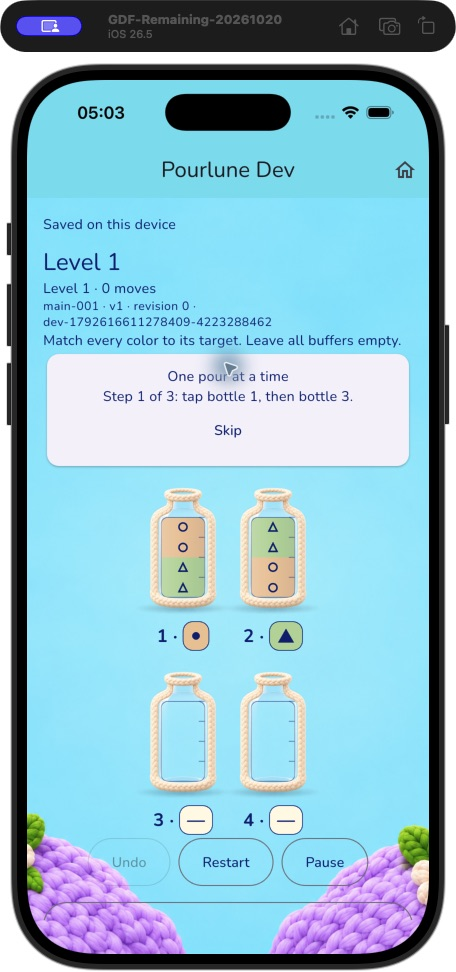
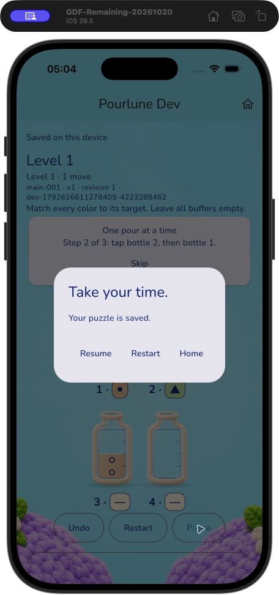
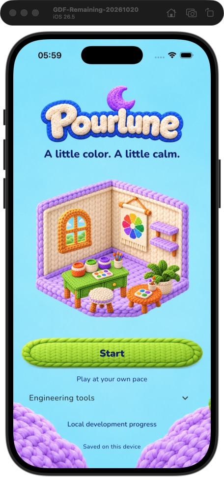
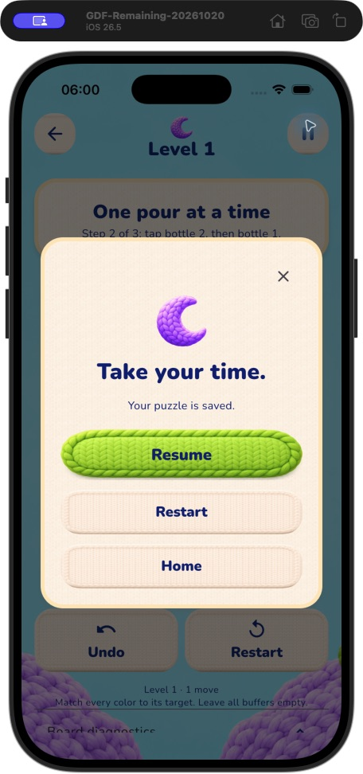

# B03 独立验收

**当前结论（第二轮）：B03 在下述开发与模拟器验证范围内通过，B03-R01/R02 关闭，可提交推送并进入 B04。** 不等于上线批准，商用权属、真人难度、Android运行、真机性能及SDK仍见边界。第二轮详见文末；第一轮证据保留。

## 第一轮历史记录

日期：2026-10-22（Asia/Taipei）。验收：Pourlune ｜ 产品架构。基线 HEAD `6699654`；对象为 B03 未提交工作区及 `deliveries/B03.md`。**结论：退回修复，未批准提交、推送或进入 B04。** 两项 P2 必须关闭。通过的自动检查保留，不以视觉问题否定题库交付，也不以自动检查代替视觉验收。

## 实际复核范围

|任务 / AC|独立证据|本轮结论|
|---|---|---|
|B03-01/02/03，AC-23/30/35|`B03-evidence/python-tests.log` 27/27；`release90.log` 90题严格发布＋目录检查；`core-tests.log` 30/30；独立代码审查复查90题及1目录路径/字节一致，三类重复均0|题库规则和打包通过；真人难度仍未验证|
|B03-07/08，AC-07/08/09/11/12/31/33|`checks.json`，Dart/Flutter格式、analyze均0退出；`app-tests.log` 82/82|现有回归通过；新增保存失败音效回归失败，见R02|
|B03-08 平台构建|`builds.json` 与两份build日志：本验收方重新执行 iOS simulator debug（22.62秒）及 Android debug（8.55秒）|构建通过；Android运行未验证|
|B03-04/05/07 原稿一致性|本轮真实 Simulator 截图01–09；对照原件boards/01与02及Visual_and_Motion_Spec|背景、瓶套、场景采用针织元素，但主页面及共用控件仍是工程样式，见R01|
|AC-04/33 保存后进程恢复|本轮自建普通App，隔离库 `b03_review_r1.sqlite`，无scenario。首步倒入后terminate/launch，同安装无重装。07→08相同实例、revision1、步数1、教学2/3、四瓶内容|此具体已保存状态的进程恢复通过；不是写入中强杀或全生命周期认证|
|B03-06 音频|读取GameAudio接入；补充真实SQLite回滚＋controller反馈回归|音效发送时序不通过；没有声明人耳听感或原生音频中断通过|

测试实际工作目录与命令记录在 `B03-evidence/checks.json`、`builds.json`。代码审查由独立新上下文 reviewer 完成，其范围未发现额外明确正确性缺陷；不替代主审截图和新增失败用例。

## 操作路径与截图

1. 已安装候选App从结算进入Level2：真实文字、瓶子语义和按钮可见；样式未达到原稿。截图01。
2. Level2暂停：文字正确，Resume/Restart/Home可操作；默认横排对话框取代原P06竖向针织卡片。截图02。
3. 返回首页：Continue与收藏场景可见；主体层级和入口样式与P02不同。截图03。
4. 每日入口：2026-10-22日历及今日入口可达；本步骤没有完成每日题。截图04。
5. 主审重新构建并安装普通App（无scenario）：新库欢迎页仅标题与扁平Start，缺P01既有品牌/场景主体。截图05。
6. Start→教学→瓶1→瓶3：真实Flutter交互，步数0→1、revision0→1，Saved后动画仍可见，动画期间棋盘按钮禁用。截图06–07。
7. terminate pid12019，原安装launch pid12100→Continue：实例 `dev-1792616611278409-4223288462`、revision1、教学2/3以及 `[G,G] / [O,O,G,G] / [O,O] / []` 一致。截图08。启动前install使旧进程已退出，随后terminate返回“无进程”不作为冷恢复；本步骤真正对照发生在其后的两次launch之间。
8. 自建App暂停：再次独立复现P06布局差异。截图09。

原图是用户提供的设计基线，本轮截图是当前实际App；示例棋盘与实际第1关定义不同不算视觉缺陷，不要求复制示意图中的错误规则。开发诊断字串本身也不单独作为缺陷。

## 必须修复

### B03-R01 · P2 · 运行界面仍保留工程布局与默认控件，未落实已批准视觉

依据：B03目标“不凭空改变已验布局”、B03-04/05/07/08，原P01/P02/P04–P06及Visual_and_Motion_Spec。定位：`app/lib/presentation/pourlune_app.dart` ThemeData；`game_screen.dart` 首页/Scaffold及229–282暂停；`board_page.dart` BoardPage。

可重复差异：P01有品牌和场景主体，实际新安装页面只显示普通标题、Start和大面积空白；P02原先以场景→拼片→Continue→三入口为层级，实际Continue提前且场景包装成普通Material卡片；P06原竖排大按钮/针织卡片变成默认AlertDialog与横排小文本按钮；P04/P05底部图标加文字操作及顶栏层级也仍是工程控件。只替换背景、瓶PNG、收藏图不能代表整体既定视觉已接入。

要求：直接复用原件与已验D01–D09的视觉/布局，将现有欢迎、首页、教学/棋盘、暂停及共用按钮/卡片/标题部件落实到Flutter；不要重新设计21页、重画整屏或把文字烘焙进图。共用部件覆盖的收藏/每日/结算页同步检查。沿用当前可交互文字、语义、48触区及全部状态，保留窄屏/大字号可滚动性。开发工具可移到已有折叠区，避免挤占主玩法；不要为了贴图引入假SDK入口或扩大功能范围。

复验：同视口、同页面状态的原稿/当前App配对截图，至少新欢迎、已进度首页、普通棋盘、暂停、结算及场景页；再核查320宽/2x、6/7等尺寸和真实操作。无需像素复制原稿概念示例，但必须恢复其主体构图、控件材质与信息层级。

### B03-R02 · P2 · 结算失败后仍触发通关音效

依据：AC-11、B03-07 保存状态一致性；执行交付声称成功反馈仅在保存后出现。定位：`game_controller.dart` `_finishMotion` 约91–101及 `_change` 约472–475；`main.dart` 将 `GameFeedback.complete` 映射到 `GameSound.win`。

独立复现使用真实sqflite_common_ffi事务：参考解前四步成功，最后一步在receipt阶段抛出错误，确认phase=failed、receipt=null、firstClears=0；调用真实动画完成入口，收到complete事件。`completion-audio-regression.log` 退出1，失败为预期empty、实际 `[GameFeedback.complete]`。测试没有替换SQLite、没有模拟错误截图。源文件 `completion-audio-regression.dart` 可复制到 `app/test/b03_review_audio_test.dart` 后在app运行；主审临时副本运行后已移除，原始失败证据保留。

根因：完成表现入口只检查内存completed，未核对已保存receipt/SavePhase。无motion路径甚至在_persist之前发送。标题组件已有存档门控，音频回调没有采用同一成功条件。

要求：通关声音在本实例结算成功且允许前台表现时触发一次，失败/写入中/仅动画结束不触发；成功Retry可正确呈现，不重复结算或重播。保留后台、离开页、旧回调与减少动态的门控。增加失败→Retry、慢写入先结束动画、无motion、重复完成回调等有效回归，不通过取消所有成功音效来规避。

## 尚待复验与外部依赖

本轮因明确缺陷退回，未重复作者6分钟原生全内容流程、18场景组合/15奖励页、音频后端探针或完整资源校验；这些仍是作者交付证据，修复后做有范围标识的独立复验。当前没有独立宣称三场景全部视觉通过、原生音频通过或B03整体通过。

源图商用权属、真人无提示难度/听感、Android操作、双端真机性能、音频中断和读屏仍未验证；不将这些外部项改成已通过，也不因它们停止已授权实现。每单位一个形状标记的轻微差异暂不作为本轮阻塞。SDK/支持身份维持B04范围。原件不变；本轮无提交、推送、合并或发布。

## 第二轮独立复验（2026-10-22 06:00 Asia/Taipei）

对象为R01/R02修复后的同一B03候选。主审重新执行命令、读取代码和真实运行截图；未把执行方的修复报告当成验收。`B03-evidence-r2/reviewed-runtime-hashes.json` 记录165个运行代码/资源文件，最终复核无漂移。原设计包未修改。

|任务 / AC|主审证据（均位于 B03-evidence-r2）|结论|
|---|---|---|
|B03-01/02/03，AC-23/30/35|沿用第一轮同一题库27 Python、90题严格检查、30核心测试及90题+目录打包对照；本轮native-full-fixed/runtime.json实载60主线/30每日，非工程场景|规则、身份、打包通过；真人难度未知|
|B03-04/05/07，AC-07/12/31/33，R01|native-design/runtime.json及25张真实截图；主审逐张检查欢迎、首页、教学、普通棋盘、暂停、结算/揭示、收藏/详情、每日及320/2x；最后普通安装截图normal-01/04|既定主体构图、信息层级和共用针织控件已落实，R01关闭|
|B03-05，AC-24～29|native-full-fixed/runtime.json及108张截图；15个里程碑原生结算/揭示，18个scene-*-composition.png已逐张打开检查|三场景0–5位置、透明边缘、增量层与收藏归属通过；无明显错位/遮挡错误|
|B03-04/07，AC-07/31/33|真实BoardView普通宽6/7瓶均84×184；320宽均66×184；empty/1/2/3/4/mixed/wrong-label图库、mid-pour液流、narrow reduced motion实渲染|容量、标签、颜色+形状、等尺寸、动画锁输入与减少动态通过；七瓶明确受控权益准备，非真实广告|
|B03-06/07，AC-11/12，R02|regression.log原失败用例通过；app-tests.log共101通过，含失败/Retry/慢写/无motion/旧实例/重复及前后台完成回调门控；新上下文代码复查无新增明确缺陷|结算成功后才发送一次成功反馈，R02关闭|
|B03-06 原生音频及资源|native-audio.log原生audioplayers六音源解码与playing/paused/stopped通过；assets.json含23资产测试和4项清单/来源校验|来源/hash/接入通过；声音人耳效果及中断未验证|
|B03-08 回归/平台|checks.json：format、analyze、101 Flutter测试退出0；native-full-fixed.json：完整原生集成退出0，用时399.37秒；builds.json：iOS simulator debug 24.74秒、Android debug 8.38秒均退出0|本批检查与双端构建通过；不代表双端实际运行或性能基准|
|B03-08，AC-04/33 真正进程恢复|normal-launch.json、normal-cold-relaunch.json、normal-02/03 PNG及AX文本。普通入口、独立库b03_review_r2.sqlite，无scenario，同安装不重装，pid33832终止后pid33937启动|实例dev-1792619967263295-2783263601、revision1、教学2/3、一步及四瓶内容一致；已保存状态冷恢复通过|

### 原生流程证据的准确范围

全内容原生测试通过，并非60关全部人工操作：20关采用真实瓶按钮的自动参考解操作（main1单列教学/撤销/提示/暂停/生命周期事件，另19关为actual_ui_reference）；其余40关明确使用真实核心参考解与原生GameStore.settle准备进度。15次里程碑均经原生结算和真实奖励/场景渲染；本次每日题按实际本地目录选择并完成。保存结果为60次主线首通、15件已揭示拼片、当日印章、61个receipt。此为自动验证，不是人类无提示通关或难度调研。

主审另用CUA操作普通构建：Start→教学瓶1→瓶3→保存→终止/启动→Continue→同实例恢复→Pause，截图normal-01～04。全内容脚本内的lifecycle通知和controller reload不被当作真正进程重启；真正重启由此独立步骤提供。

全内容首次运行`native-full.log`在旧AlertDialog断言处失败。根因是R01已换成pause-card，脚本尚未更新。修复仅调整测试定位、核验已保存文案与三动作、SQLite一致性及清理；主审核对后重新运行完整流程。保留该失败和`native-full-fixed.log`成功证据，未用删除断言或仅重跑子路径代替全流程。

### 视觉结论与后续边界

主审对照原P01/P02/P04–P06、P10–P14及修正后的产品规则，接受本批运行视觉：品牌/场景欢迎、场景→拼片→继续→三入口首页、真实瓶体分层、竖向暂停和同源收藏组合已建立。这里是本次iOS模拟器和明确320/2x测试视口的视觉/交互验收，不是全设备或完整读屏认证。

三项非阻塞轻微待办列入B04-08：320/2x Restart词内换行、Rules返回Settings但语义名Home、连续同色每单位重复形状。它们未造成当前免费操作不可达，仍需修整，不标为已修复。

商用美术权属、人类关卡难度与听感、音频来电/设备路由中断、Android实际操作、物理设备性能/内存/电量与读屏仍未通过。源图仅保留候选身份；Nunito带OFL，原创音频来源有记录。Firebase、AdMob、正式支持身份属于B04且尚未声称接入。没有商店提交、生产发布或main合并。

**验收决定：关闭B03-R01/R02，接受B03限定开发范围，连同证据提交开发分支并启动B04完整任务包。**
