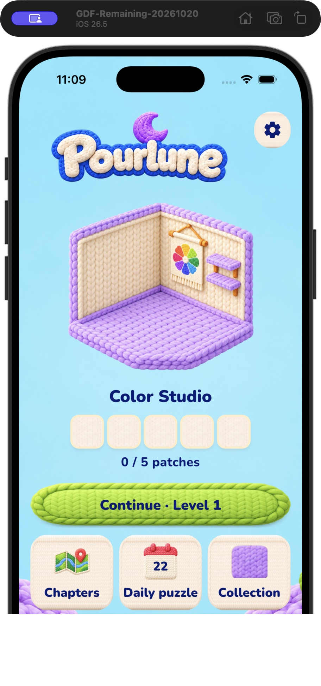
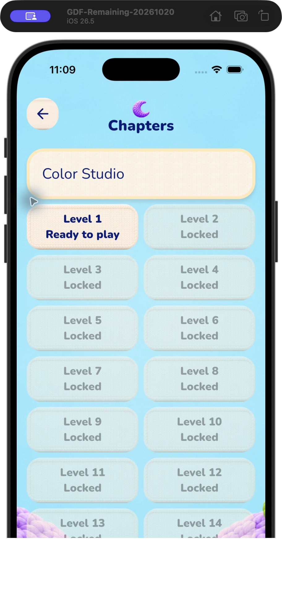

# Pourlune 动效体验初审与改进建议

2026-10-22；对象为用户明确指出的正式Flutter App／模拟器。此报告为当前可见流程与源码初审，不是完成改造或性能验收。

## 当前证据

1. 首页：真实模拟器可访问，既有编织美术完整；保留现有视觉，未操作进度。截图01。
2. 首页→章节：实际点击Chapters进入，页面与关卡语义可用；源码game_screen.dart:371按GamePage直接替换body，缺少统一转场宿主。截图02只证明目的页面状态，不能证明动画帧率或时长。
3. 章节→首页：实际返回成功，回到原Continue Level1及0/5状态；未开始关卡、重装或清理存档。

## 代码可确认的问题

- main.dart的Bootstrap等待本地题库/存档/初始化，准备时用默认MaterialApp和CircularProgressIndicator，完成后换为PourluneApp；没有连续的品牌启动过渡。本次未重启测冷启动，不能断言等待耗时。
- game_screen.dart以switch(c.page)直接替换body；背景复用，但标题/内容缺少按导航方向组织的进退场。
- knit_components.dart按钮背景处理disabled状态，但没有统一的按下压缩与释放回弹；原生按钮仍有基础反馈，不能说完全无反馈。
- 倒水已有分段抬起/倾倒/回位，普通时长固定900ms；拼片已有700ms淡入加0.88→1缩放。现状是局部动画，不能说完全没有动画；是否偏慢及卡顿须录屏/真机测量。
- 当前源码检索未见precacheImage路径；图片首次解码是否造成掉帧尚未测量。不能把大图/重建直接认定为已证实性能瓶颈。

## 建议的表现方向

保留编织、柔软、温暖的原始UI，通过短促按压、轻微弹性、清楚的前后层次与音画同步形成游戏感。普通导航迅速，通关与场景揭示有节奏，静止界面保持安静。以下数值为Pourlune的首轮调校起点，不是竞品实测值，也不是已通过的性能结论。

|环节|首轮建议|判据|
|---|---|---|
|启动|沿用背景/Logo的品牌启动层，资源就绪后180–250ms衔接首页；不设强制等待或假百分比|无白屏/默认转圈跳变；失败可重试；首个可交互时间单独测量|
|按钮|按下60–90ms压至约0.96，释放120–180ms回位，轻微弹性；保持点击区域和语义|按下即有反馈；取消手势恢复；连点不重复业务提交|
|普通页面|约220–300ms短距离位移＋透明度；返回方向对应，背景稳定|出场内容不再响应点击/读屏；标题与正文一起过渡；不同页保留合适滚动位置|
|弹窗|背景遮罩与面板分别入场，面板约180–240ms小幅缩放；关闭更快|焦点进入弹窗，背景不可操作，关闭还原焦点；不大幅飞入|
|进局与倒水|棋盘准备就绪再呈现，瓶子错峰30–45ms，整组约300ms内落稳；倒水按液量调校分段速度|首步操作及时，瓶口/水流/液面/音效同步；不以动画推进持久化|
|通关→拼片→下一关|最后一倒落稳、胜利确认、奖励出现、拼片归位；预备下一页资源|先真实落盘再展示成功；普通胜利短，章节奖励更完整；快速Next/后台中断不能卡住或重复发奖|
|性能|只预热首页和即将进入页需要的图，限制解码尺寸，减少无关重绘|代表设备profile记录首帧/交互延迟/UI与raster耗时/长帧；不靠debug模拟器宣称达标|

减少动态效果时去掉位移/弹跳/装饰，只保留短透明度或即时切换；音效、触感遵守设置。不能因为动效锁住返回、重试或存档恢复。

## 改造顺序与验收

先做“启动→首页→进入/恢复关卡→暂停→返回首页”的完整切片，调好时长、输入与资源准备，再扩展章节、收藏、通关/拼片/下一关。首批不重做UI、不更换引擎、不接入复杂动画依赖。

验收必须有改造前后同设备录屏、实际连续操作、冷/热进入、大字/减少动态效果、快速连点/返回、前后台中断与保存失败路径。以稳定60fps为初步设备目标（帧预算约16.7ms），需结合帧耗时分布及可感知长帧，不能只看平均帧率。120Hz设备另按实际显示模式核验。

Firebase注册接入仍是正在执行批次；本报告未修改并行实现，也未将动效建议标为已验收。后续实施须协调main.dart及服务启动相关文件的所有权。

## 参考边界

已核对Magic Sort开发商页面与Meowdoku发行商商店页，但本次没有取得两款游戏同版本的可逐帧实机录屏。因此参考其产品方向，不声称测得竞品具体动画曲线/时间/帧率。

- https://grand.gs/games/
- https://apps.apple.com/us/app/meowdoku/id6761760135
